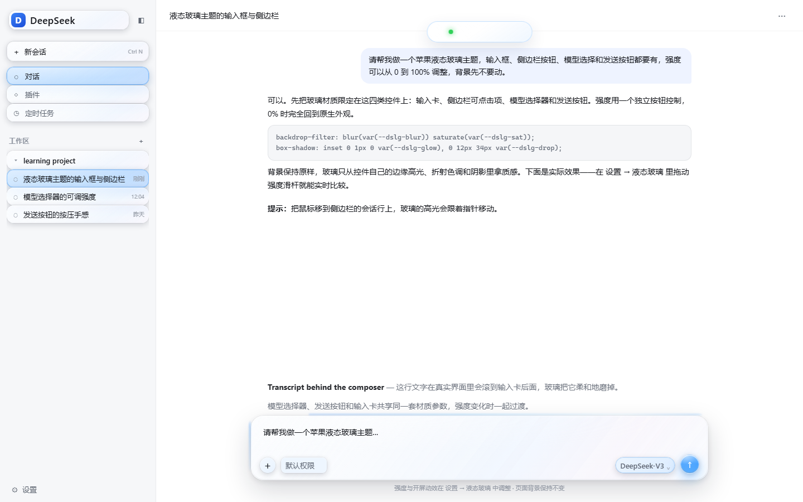
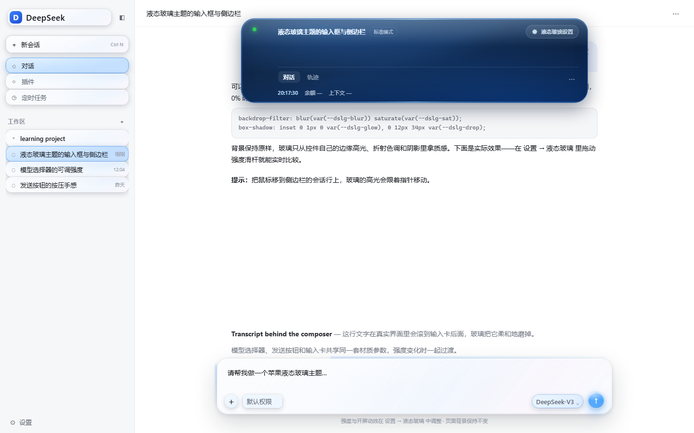
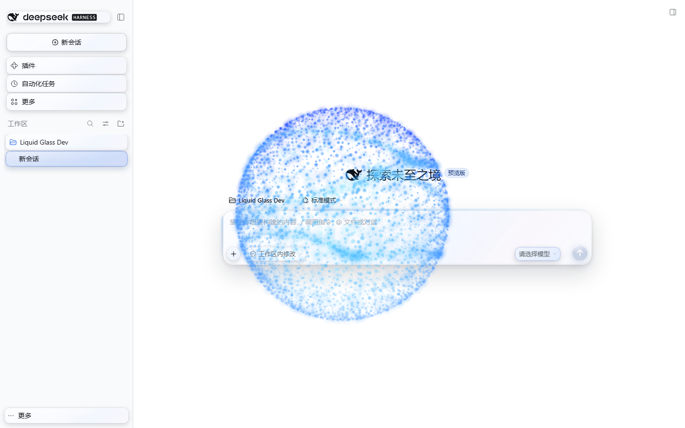
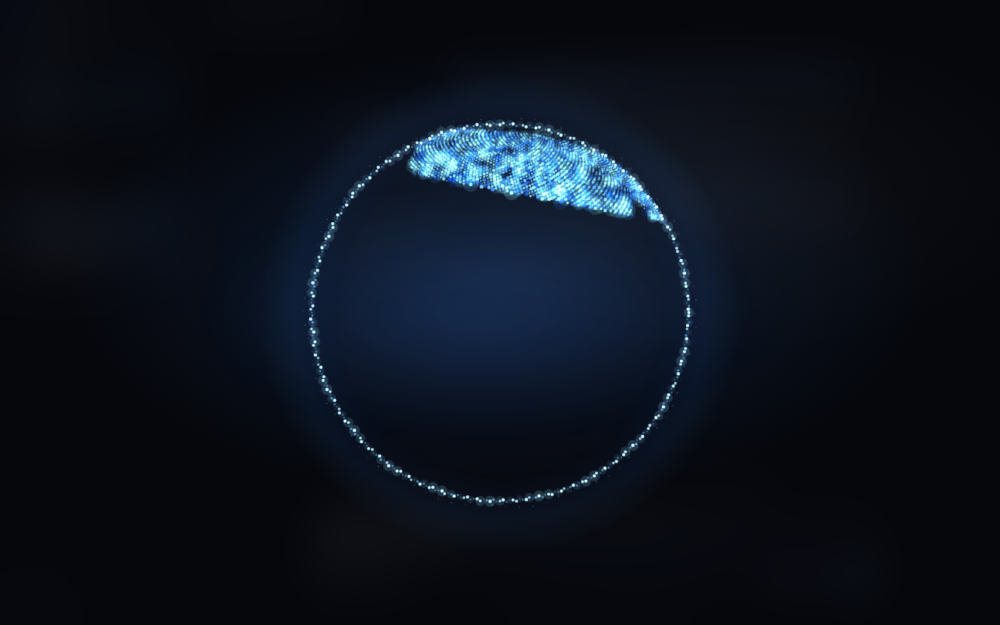

# Liquid Glass — DSH Apple Liquid Glass

An Apple-style liquid-glass material for the DeepSeek Harness web client: composer, sidebar controls, model picker, and send button, with a faint flowing blue glow along the composer's top edge and sides that freezes while you type. The opening is a rotating blue-particle Earth with blank oceans and flowing land particles; it reads the visitor IP, spins 4 seconds, then blinks a red spot at that location for 3 seconds, with a glass skip button. Switching models spawns a small particle orb above the model trigger, and a Dynamic Island at the top integrates the conversation header and Liquid Glass settings. The original four per-surface **scope** switches are preserved. Intensity, scope, and splash are configured in **Settings → Liquid Glass**. The page background stays untouched.








> Captured in a real DSH 0.2.1-rc.5 web profile.

---

## Install

Repository: <https://github.com/tianyuec11-design/dsh-apple-liquid-glass>

### From GitHub (recommended)

**DSH Desktop**

1. Open **Plugins** in the sidebar.
2. Click **Add plugin / +** and choose **Install a third-party plugin**.
3. Paste the repository URL:

   ```text
   https://github.com/tianyuec11-design/dsh-apple-liquid-glass
   ```

4. Install, then **Enable** it. Refresh the page (or restart if the host asks).
5. Open **Settings** (bottom-left account menu → Settings) → **Liquid Glass**. The intensity slider and the **Opening animation** switch live there.

**`dsh web`**

```powershell
dsh plugin --profile web add 'github:tianyuec11-design/dsh-apple-liquid-glass'
```

Restart `dsh web` afterwards. `dsh plugin` needs pnpm on `PATH`; the Desktop app ships its own package manager.

**GitHub Release tarball**

A pinned release is also available as:

```text
https://github.com/tianyuec11-design/dsh-apple-liquid-glass/releases/download/v0.7.0/dsh-apple-liquid-glass-0.7.0.tgz
```

> dshmarket's **Themes** tab only lists themes in its catalog. A GitHub-installed theme appears under **Installed plugins**; it is still a complete bundle theme and can be enabled or disabled normally.

### From a local folder (development)

1. **Plugins → Add plugin / + → Install a third-party plugin**.
2. Paste the absolute path to this folder (replace with your local checkout):

   ```text
   C:\path\to\dsh-apple-liquid-glass
   ```

3. Install → **Enable** → refresh.

Local `dsh web` install:

```powershell
dsh plugin --profile web add "C:\path\to\dsh-apple-liquid-glass"
```

### From a self-built tarball

```powershell
node scripts/build.mjs
npm pack
```

Then install `dsh-apple-liquid-glass-0.7.0.tgz` through the plugin manager.

---

## Use

Everything lives in **Settings → Liquid Glass**; the chat surface has no floating button.

- **Glass intensity**: 0–100% slider with presets **Off / Light / Mid / Strong** = 0 / 35 / 65 / 100; applies live and saves automatically.
- **Surfaces**: the original four independent switches — composer card, sidebar controls, model picker, send button. Turn one off and it keeps its native look while the rest stay glass.
- **Dynamic Island**: a 5cm × 1cm deep-navy glass pill at 1cm from the top, centred on the composer column, with a refractive rim. Collapsed it has no text, only a state dot 0.6cm from its left (red while DSH is thinking, green when idle). Click to expand into the conversation title, mode, chat/trajectory tabs, time, balance, context usage, and the Liquid Glass settings shortcut.
- **Opening animation**: switch. Enabling it previews once; afterwards it plays once per DSH window session (a same-tab refresh does not repeat it).
- **Tip entry**: expand the island and click **♥ Tip** to open the DSH/DeepSeek top-up page. After the balance increases, a heart (≤10), sports car (10–20) or rocket (>20) effect plays automatically.
- **Model-switch particle orb**: automatic. After switching to a different model, a ~1/6-size blue orb appears just above the model trigger, flows for 5s and fades for 5s. It is transparent and pointer-transparent.
- The choice persists per browser in `localStorage` (key `dsh-apple-liquid-glass.settings.v1`).
- **0% removes every surface override**; the opening animation remains controlled by its own switch.

### Surfaces

In **Settings → Liquid Glass → Surfaces**, each switch is independent:

| Switch | Covers |
| --- | --- |
| Composer card | The input card, `+`, access-mode pill, and the blue top/side glow |
| Sidebar controls | New session, panel rows, workspace rows, session rows, icon buttons, search field |
| Model picker | The model trigger inside the composer |
| Send button | Send / stop button |

All four are on by default. Turning one off restores that surface to native immediately while the others stay glass; the choice survives a reload. The blue edge glow belongs to **Composer card**, so turning that off removes it too. At 0% every surface is native, but the four switch states are preserved.

### Composer edge glow

- When glass is on, a blue gradient halo runs along the composer's top edge and both sides.
- A 2px strip plus a 1.5px blur keeps the visible thickness under **1.5mm (about 5.67 CSS px)**.
- Typing, key presses, or IME composition freeze the flow immediately; it resumes about 1.1s after the last input.
- At 0% or with glass off, the glow disappears completely.

### Opening animation

- A full-screen rotating Earth: an equirectangular texture built from Amap map tiles is mapped onto a WebGL sphere, showing real continent outlines; the ocean is translucent deep blue and a ring of blue light points traces the rim. It falls back to particles when WebGL is unavailable.
- The globe is colour-graded from deep blue to light blue, rotates around its vertical axis with a ~23° tilt, and the red spot is placed on the real latitude/longitude projection.
- The ocean is a translucent deep blue while the land keeps the Amap tile texture; rim points, atmospheric glow and the red location pulse sit on top.
- The opening resolves the visitor IP first (short timeouts, session cache, timezone fallback), then spins the globe **1–2 turns over 4 seconds** to the target longitude.\n- A **blinking red spot appears at the IP location for 3 seconds**; a liquid-glass Skip button sits at the bottom-right, and clicking anywhere / `Esc` also skips.\n- Paste an Amap **Web service key** in the island panel under Amap location to use Amap IP + reverse geocoding and show the city; without it the opening falls back to IP services / the system timezone.
- With `prefers-reduced-motion`, one static frame is shown for about 2.6 seconds.
- 

### Model-switch particle orb

- After opening the model picker and switching to a **different model**, a blue particle orb appears just above the model trigger.
- It is now about **1/6** of the previous size (96px canvas) instead of a centred 560px sphere. The 5s flow + 5s fade, gradient-blue palette and pointer transparency are unchanged.
- Only the particles occlude; the UI around the orb remains visible and usable.
- It fires only when the user has interacted with the model selector recently and the model label actually changes. Reduced-motion shortens it.

### Dynamic Island

- A glass pill centred on the composer column, **1cm from the top**, **5cm × 1cm** collapsed, with the same material as the composer.
- Collapsed it displays **no text**, only a dot 1cm from the left: red while DSH is thinking/generating, green when idle.
- Click to expand into the conversation title, mode, 对话/轨迹 tabs, and a Liquid Glass settings gear that opens **Settings → Liquid Glass**.
- The original header is temporarily hidden while expanded to avoid duplication; outside click or `Esc` restores it.

### Material scope

| Area | Elements |
| --- | --- |
| Composer | Input card, `+` add button, access-mode pill |
| Composer edges | Flowing blue glow on the top edge and both sides |
| Left sidebar | Brand/new-session, panel nav rows, workspace rows, session rows, settings/account row; small icon buttons on hover/focus |
| Model picker | The model trigger inside the composer |
| Send | Send/stop button |

The page background, message bubbles, header, and the model dropdown menu itself are out of scope for this version. See **Surfaces** above for which switch covers which area.

---

## How it works

- Pure CSS material, a tiny DOM controller, a React settings section, and a 2D canvas particle layer; none of them needs a third-party runtime dependency.
- The composer's `backdrop-filter` lives on a `::before` pseudo-element so the card never becomes the backdrop root of its fixed-position popups; `isolation: isolate` keeps the stacking local.
- The blue edge glow lives on the card's `::after`: two side gradients plus a top gradient animated through `background-position`. While typing, the controller sets `data-dslg-typing="true"` on the card and CSS pauses the animation.
- Sidebar styling targets clickable elements, never the whole column, so the background stays native.
- Pointer movement updates `--dslg-mx/--dslg-my` for a moving specular highlight. Press feedback uses the individual `scale` property so the host's own `transform` survives.
- At 0% the controller removes `body[data-dslg-glass="on"]` and every `--dslg-*` variable; all surface selectors stop matching.
- The Settings section registers through DSH's `settings.section` slot (`slots` + `locale`); no button is added to the chat surface.
- Surface scope is stored as `surfaces` (composer / sidebar / model / send). The controller writes `body[data-dslg-composer|sidebar|model|send="on|off"]`, and every material selector is narrowed by its surface attribute, so turning one off removes only that group of overrides.
- The opening is now a full-screen canvas particle Earth: low-resolution continent polygons, Fibonacci sphere sampling, orthographic projection with vertical-axis rotation/tilt, additive rim and land particles, and a flowing deep-blue-to-light-blue colour phase. The ocean is never filled; an animation state machine drives the 4-second 1–2-turn spin and the 3-second red pulse at the IP projection.
- The model-switch orb is a 96px 2D canvas: Fibonacci sphere + two flowing ribbons, theme-aware blue/cyan sprites, and a `source-atop` gradient tint. It is positioned just above the model trigger, pointer-transparent, and removed after 5s of flow + 5s of fade.
- The Dynamic Island is a fixed glass pill sized 5cm × 1cm at top 1cm, horizontally centred from the composer's bounding box. It expands to 680px × 150px. The state dot watches the composer's primary button `aria-label` (e.g. 停止生成) and `aria-busy`; the expanded header is read from the host title/mode/tab DOM and temporarily hidden behind the island.
- The model trigger is watched with a `MutationObserver` on its accessible name/text. The sphere only plays when the user interacted with the model selector in the last 15s and the model label actually changed, so initial model hydration does not fire it.
- `prefers-reduced-motion` and `prefers-reduced-transparency` are respected.
- Light/dark follows the host through `body[data-ds-dark-theme]`; the particle palette adapts to the theme.

### Files

```text
dsh-apple-liquid-glass/
├─ package.json
├─ cordis.patch.yml          # bundle registration
├─ lib/
│  ├─ index.js               # host half: intentional no-op
│  └─ client.js              # built browser bundle
├─ src/
│  ├─ client.js              # material, settings, splash, particle source
│  └─ style.css              # material, settings, splash, particle styles
├─ assets/
│  ├─ fonts/                 # Dancing Script WOFF2 + OFL
│  └─ icon.svg
├─ scripts/build.mjs         # wraps the ModuleLoader bundle and inlines the font
├─ preview/harness.html      # static development preview
├─ docs/                     # README screenshots
└─ LICENSE
```

### Development

```powershell
node scripts/build.mjs
start .\preview\harness.html
```

The preview accepts `?theme=light|dark&level=0..100&splash=1&typing=1&hover=1&lang=en`. It uses a mock host DOM; the settings section needs a real DSH host.

After installing from a local folder, DSH HMR may reload the bundle automatically. If not, refresh the page or restart the host. The Desktop plugin manager installs a copy, so reinstall after source changes, or use a link install during development.

---

## Compatibility

- DSH **>= 0.2.1-0**.
- Verified on **DSH 0.2.1-rc.5** (web profile): light/dark, 0%/62%/100%, glow pause while typing, all four surface switches and their persistence across reload, settings slider and splash switch, stroke-order writing and skip, and the particle sphere's transparent occlusion / pointer pass-through / 5+5s timing / auto-removal.
- The model-switch trigger path was verified against the real model trigger: changing its accessible name/text starts the sphere. The dev profile had no selectable models, so a real menu-item click was not available; the watcher uses the same post-switch label change in a normal host.
- Desktop uses the same web client; the settings section relies on the host's `settings.section` / `slots` / `locale` services, available in 0.2.1.
- Chromium/Electron only; Safari/Firefox are not tested.

### Known limitations

- The model dropdown menu, message bubbles, and header are not themed yet.
- Small sidebar icon buttons get the material on hover/focus only, to avoid a wall of blur.
- No SVG edge refraction yet; the current material is blur + saturation + translucent tint + specular highlight + bevel + shadow.
- The opening animation is an approximation of Apple's event style, not Apple's proprietary artwork; it uses bundled Dancing Script with Snell Roundhand / Apple Chancery as system fallbacks.
- The stroke reveal uses one centreline mask path plus a wide soft stroke, not per-glyph vector strokes; the font and blue/white gradient are unchanged.
- The model-switch particle orb is a stylised particle approximation of the reference image, not the image asset itself. It is about 96px and sits above the model trigger instead of centring on the viewport.
- The sphere only appears when the model label changes after a recent model-selector interaction; initial hydration and same-model selection do not fire it. There is no separate switch; reduced-motion shortens it.
- The splash plays once per window session; a same-tab refresh does not repeat it. Toggle it off and on in Settings to preview again.
- The glow resumes about 1.1s after the last keystroke by design.
- No wallpaper and no page-background changes.

---

## Uninstall

- **Desktop**: Plugins page → this plugin → **Remove**; restart if prompted.
- **Web**:

  ```powershell
  dsh plugin --profile web remove dsh-apple-liquid-glass
  ```

---

## License

MIT. See [LICENSE](LICENSE).

The opening font **Dancing Script** © The Dancing Script Project Authors, distributed under the SIL Open Font License 1.1; see [assets/fonts/OFL.txt](assets/fonts/OFL.txt).

"Liquid Glass" describes the visual material. This project is not affiliated with or endorsed by Apple Inc.


