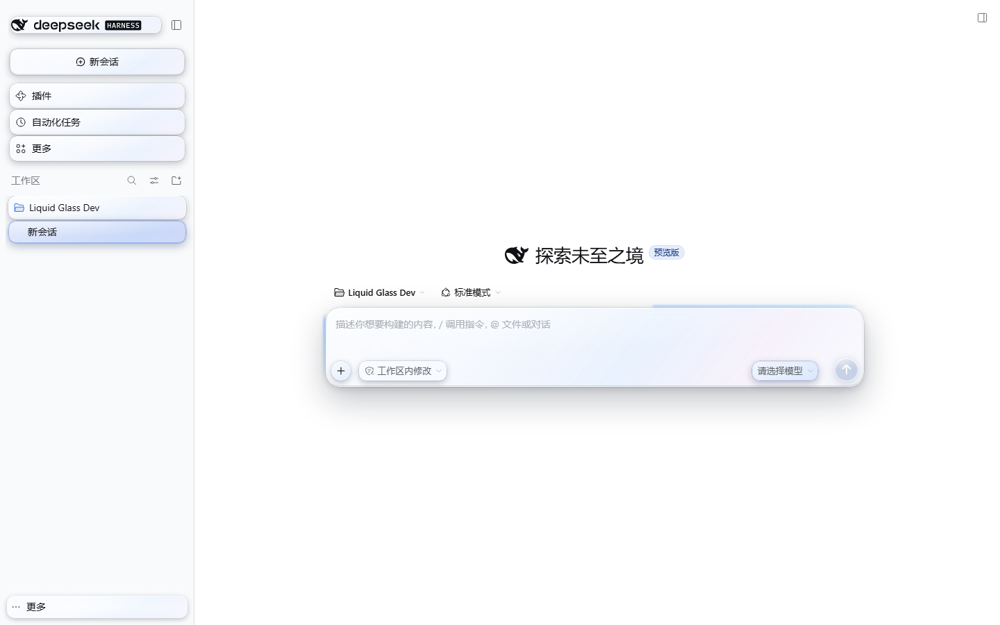
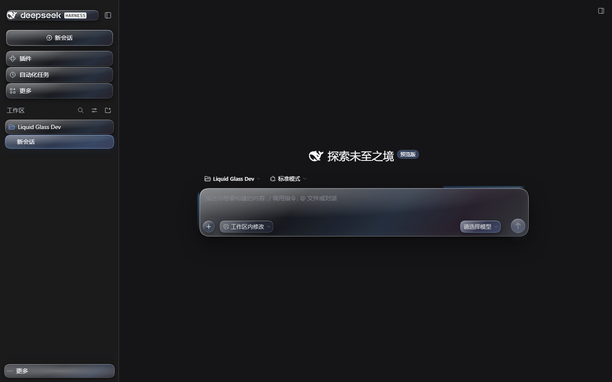
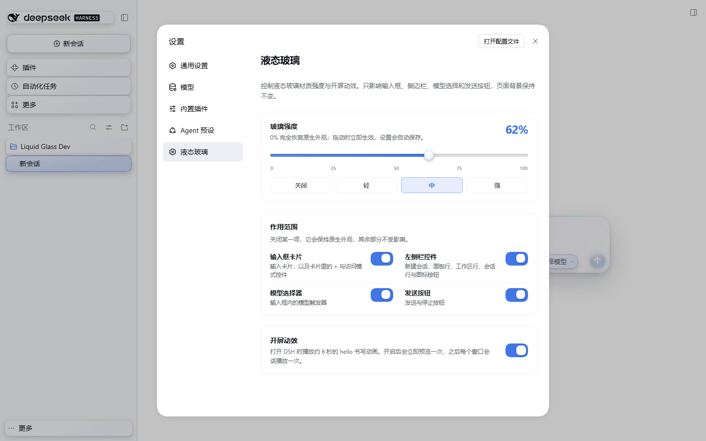
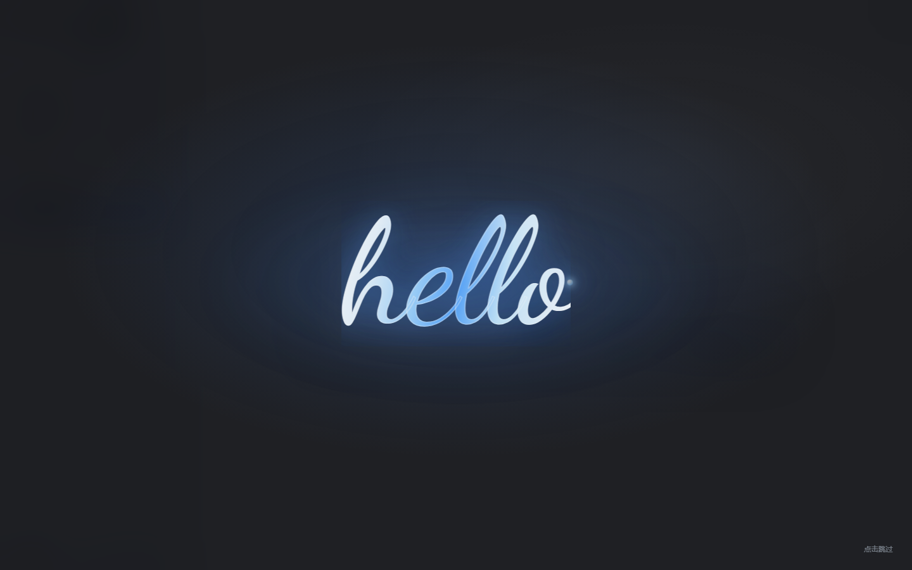

# 液态玻璃 · DSH Apple Liquid Glass

给 DeepSeek Harness 的输入框、左侧侧边栏可点击项、模型选择器和发送按钮加一层 Apple 风格的液态玻璃材质；输入框上沿与两侧有一条会轻微流动的蓝色光晕，打字时自动停住。另带一个约 6 秒的 hello 手写开屏动效，以及保留原有四项 **作用范围** 开关。强度、作用范围和开屏动效都在 **设置 → 液态玻璃** 里控制，聊天界面不再有悬浮按钮。页面背景保持不变。









> 截图来自真实的 DSH 0.2.1-rc.5 Web profile。主题不修改页面背景，只处理指定控件与开屏层。

---

## 安装

仓库：<https://github.com/tianyuec11-design/dsh-apple-liquid-glass>

### 方式一：从 GitHub 安装（推荐）

**DSH Desktop**

1. 打开 DSH Desktop，进入侧边栏的 **插件** 页面。
2. 点 **添加插件 / +**，选择 **安装第三方插件**（Install a third-party plugin）。
3. 粘贴仓库地址：

   ```text
   https://github.com/tianyuec11-design/dsh-apple-liquid-glass
   ```

4. 点 **安装**。完成后点 **启用**，刷新页面（或按宿主提示重启）。
5. 打开 **设置**（侧边栏左下角账号菜单 → 设置）→ **液态玻璃**。玻璃强度滑杆和 **开屏动效** 开关都在这个设置页里。

**`dsh web`**

```powershell
dsh plugin --profile web add 'github:tianyuec11-design/dsh-apple-liquid-glass'
```

然后重启 `dsh web`（或按 CLI 提示操作）。`dsh plugin` 需要 PATH 里有 pnpm；桌面版由桌面应用自带包管理器，不需要你手动装 pnpm。

**GitHub Release 压缩包**

也可以直接安装固定版本：

```text
https://github.com/tianyuec11-design/dsh-apple-liquid-glass/releases/download/v0.2.1/dsh-apple-liquid-glass-0.2.1.tgz
```

> dshmarket 的 **主题** 标签页只列出目录中收录的主题；从 GitHub 安装的这个主题会出现在 **已安装插件** 里，这是正常的。它仍然是一个完整的 bundle 主题插件，可以正常启用/停用。

### 方式二：从本地文件夹安装（当前开发版）

1. 插件页 → **添加插件 / +** → **安装第三方插件**。
2. 粘贴这个文件夹的绝对路径（把下面替换成你本机的仓库位置）：

   ```text
   C:\path\to\dsh-apple-liquid-glass
   ```

3. 安装 → **启用** → 刷新。

如果插件管理器不方便选文件夹，也可以使用构建好的压缩包（见下方「构建安装包」），把 `.tgz` 的绝对路径粘贴进去。若你的桌面版不接受本地压缩包，请改用文件夹路径。

`dsh web` 的本地安装命令：

```powershell
dsh plugin --profile web add "C:\path\to\dsh-apple-liquid-glass"
```

### 方式三：自己构建压缩包

在插件目录运行：

```powershell
node scripts/build.mjs
npm pack
```

会生成 `dsh-apple-liquid-glass-0.2.1.tgz`。在插件管理器的「安装第三方插件」里粘贴这个 `.tgz` 的绝对路径即可。

---

## 使用

所有控制都在 **设置 → 液态玻璃**，聊天/开始对话界面不再有悬浮按钮。

- **玻璃强度**：0–100% 滑杆，四个快捷档 **关闭 / 轻 / 中 / 强** = 0 / 35 / 65 / 100；拖动立即生效并自动保存。
- **作用范围**：保留原来的四项独立开关——输入框卡片、左侧栏控件、模型选择器、发送按钮。关掉某一项，它保持原生外观，其余部分不受影响。
- **开屏动效**：开关。开启时会立即预览一次；之后每次打开 DSH 窗口会话播放一次（同一标签页刷新不会重复播放）。
- 设置按浏览器保存（`localStorage` 键：`dsh-apple-liquid-glass.settings.v1`），刷新、重启后保留。
- **0% 不是半透明，而是完全移除主题覆盖**：所有表面回到 DSH 原生渲染，开屏动效仍由独立开关控制。

### 作用范围

在 **设置 → 液态玻璃 → 作用范围** 里，四项开关各自独立：

| 开关 | 覆盖 |
| --- | --- |
| 输入框卡片 | 输入卡、`+`、访问模式胶囊，以及上沿/两侧的蓝色光晕 |
| 左侧栏控件 | 新建会话、面板行、工作区行、会话行、图标按钮、搜索框 |
| 模型选择器 | 输入框内的模型触发器 |
| 发送按钮 | 发送 / 停止按钮 |

四项默认全开。关闭某一项后，它立即回到原生外观，其余部分不受影响；刷新、重启后保留。蓝光晕跟随「输入框卡片」这一项，关掉它时一起消失。0% 时所有表面原生，但四项开关的状态不会被清空。

### 输入框光晕

- 玻璃开启时，输入卡上沿与左右两侧出现一条蓝色渐变光晕，带轻微流动。
- 光晕由 2px 色带 + 1.5px 模糊组成，视觉厚度控制在 **1.5mm（约 5.67 CSS px）以内**。
- 在输入框里打字、按键或输入法组词时，光晕立即冻结；停手约 1.1 秒后恢复流动。
- 0% 或关闭玻璃时，光晕完全消失。

### 开屏动效

- 仿 Apple 活动开场的写法：半透明磨砂黑背景，浅蓝白渐变的 lowercase **hello** 从左到右书写，带一点玻璃高光和笔尖光点。
- 时长约 6 秒；点击任意位置或 `Esc` 可跳过。
- 字体使用随插件打包的 **Dancing Script**（SIL OFL 1.1），在小写花体、圆润和均匀粗细之间取平衡；同时列出 Snell Roundhand / Apple Chancery 作为系统后备。
- `prefers-reduced-motion` 下显示静态 hello，约 2 秒后淡出。

### 玻璃范围

| 区域 | 具体元素 |
| --- | --- |
| 输入框 | 输入卡片、`+` 添加按钮、访问模式胶囊 |
| 输入框边缘 | 上沿与左右两侧的蓝色流动光晕 |
| 左侧侧边栏 | 品牌/新建会话、面板导航行、工作区行、会话行、底部设置/账号行；小图标按钮在悬停/聚焦时呈现玻璃 |
| 模型选择 | 输入框内的模型选择触发器 |
| 发送 | 发送/停止按钮 |

页面背景、对话气泡、顶部栏、模型下拉菜单本身暂不处理；这些留到后续迭代。区域与开关的对应关系见上面的「作用范围」。

---

## 实现说明

- **纯 CSS 材质 + 一个轻量 DOM 控制器 + 一个 React 设置区**；材质与开屏动效不依赖第三方库。
- 输入卡的 `backdrop-filter` 放在 `::before` 伪元素上，避免把输入卡变成内部 fixed 弹层的 backdrop root；层叠用 `isolation: isolate` 隔离。
- 输入框蓝光晕放在卡片的 `::after` 伪元素上，用两条侧边渐变 + 一条上沿渐变和 `background-position` 动画实现；打字时控制器给卡片加 `data-dslg-typing="true"`，CSS 暂停动画。
- 侧边栏只处理可点击元素本身，不绘制整个侧边栏，因此背景保持原样。
- 指针移动时通过 `--dslg-mx/--dslg-my` 更新高光位置；按压时用 `scale` 做轻微液体回弹，不覆盖宿主自己的 `transform`。
- 0% 时移除 `body[data-dslg-glass="on"]` 与全部 `--dslg-*` 变量，所有表面选择器失效，原生样式不受影响。
- 设置区通过 DSH 的 `settings.section` 槽注册（`slots` + `locale`），不向聊天界面添加任何按钮。
- 作用范围保存为 `surfaces`（composer / sidebar / model / send），控制器把它们写成 `body[data-dslg-composer|sidebar|model|send="on|off"]`，CSS 的每一组表面选择器再按对应属性收窄；关掉一项时只移除那一组覆盖。
- 开屏动效由纯 DOM 全屏层实现：内嵌 Dancing Script WOFF2、`@property --dslg-reveal` 驱动的软边遮罩、渐变文字与笔尖光点；字体加载完成后才开始书写，避免先闪回退字体。
- 尊重 `prefers-reduced-motion` 与 `prefers-reduced-transparency`。
- 深浅色跟随宿主：宿主设置 `body[data-ds-dark-theme]` 时自动切换深色玻璃。

### 文件结构

```text
dsh-apple-liquid-glass/
├─ package.json
├─ cordis.patch.yml          # bundle 注册
├─ lib/
│  ├─ index.js               # 宿主半：空实现
│  └─ client.js              # 构建产物，浏览器半
├─ src/
│  ├─ client.js              # 材质、设置区、开屏动效源码
│  └─ style.css              # 材质、设置区、开屏动效样式
├─ assets/
│  ├─ fonts/                 # Dancing Script WOFF2 + OFL
│  └─ icon.svg
├─ scripts/build.mjs         # 包装 ModuleLoader bundle 并内嵌字体
├─ preview/harness.html      # 本地静态预览（开发用）
├─ docs/                     # README 截图
└─ LICENSE
```

### 开发

```powershell
# 修改 src/style.css 或 src/client.js 后
node scripts/build.mjs

# 静态预览（先构建，然后用浏览器打开）
start .\preview\harness.html
```

预览页支持 `?theme=light|dark&level=0..100&splash=1&typing=1&hover=1&lang=en`。它用模拟 DOM 展示材质与开屏动效；设置区需要真实 DSH 才能看到。

用本地文件夹安装后，DSH 的 HMR 可能会直接重载；如果样式没变，刷新页面或重启宿主。桌面版插件管理器安装的是一份副本，修改源码后需要重新安装或改用 link 安装。

---

## 兼容性

- 要求 DSH **>= 0.2.1-0**。
- 已在 **DSH 0.2.1-rc.5 Web profile** 实机验证：浅色 / 深色、0% / 62% / 100%、输入时暂停光晕、四项作用范围开关及其刷新持久化、设置区滑杆与开屏开关、开屏动效播放与跳过。
- 桌面版使用同一套 Web 客户端；设置区依赖宿主的 `settings.section` / `slots` / `locale` 服务，0.2.1 已具备。
- 只在 Chromium/Electron 内核验证；没有测试 Safari/Firefox。

### 已知限制

- 模型下拉菜单本身、对话气泡、顶部栏不在本版范围内。
- 侧边栏里的小图标按钮为了性能和视觉克制，只在悬停/聚焦时出现玻璃；主要行是常驻玻璃。
- 还没有 SVG 边缘折射；目前是「模糊 + 饱和度 + 透明染色 + 高光 + 倒角 + 阴影」的 CSS 材质。
- 开屏动效是 Apple 开场风格的近似，不是 Apple 官方素材；字体使用开源的 Dancing Script，并以 Snell Roundhand / Apple Chancery 作为系统后备。
- 开屏动效按窗口会话只播放一次；同一标签页刷新不会重复。需要再次观看可在设置里关闭再打开开关，会立即预览。
- 光晕在停止输入约 1.1 秒后恢复流动；这是有意的时间窗，避免每个按键都重置动画。
- 不使用壁纸，不修改页面背景。想要更强的「透出桌面壁纸」效果，需要后续增加背景层或桌面透明支持。

---

## 卸载

- **Desktop**：插件页面 → 这个插件 → **移除**；按提示重启。
- **Web**：

  ```powershell
  dsh plugin --profile web remove dsh-apple-liquid-glass
  ```

  重启 `dsh web` 即可完全移除。

---

## 许可

MIT。见 [LICENSE](LICENSE)。

开屏字体 **Dancing Script** © The Dancing Script Project Authors，按 SIL Open Font License 1.1 分发；完整许可见 [assets/fonts/OFL.txt](assets/fonts/OFL.txt)。

「Liquid Glass」在这里描述视觉材质；本项目与 Apple Inc. 无隶属或背书关系。
